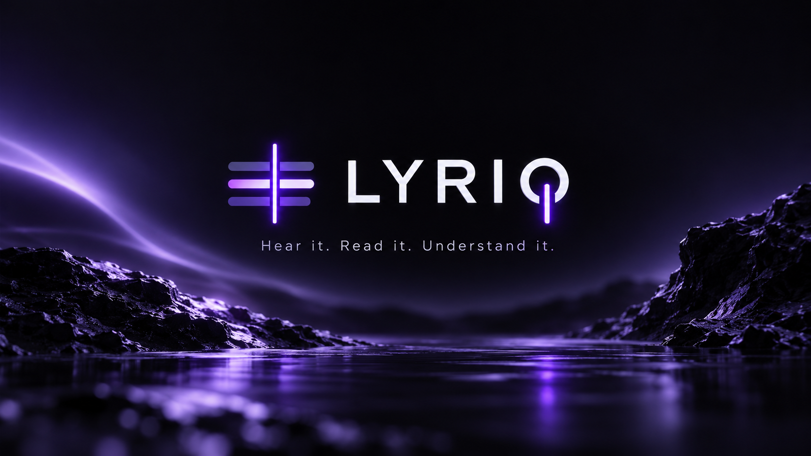
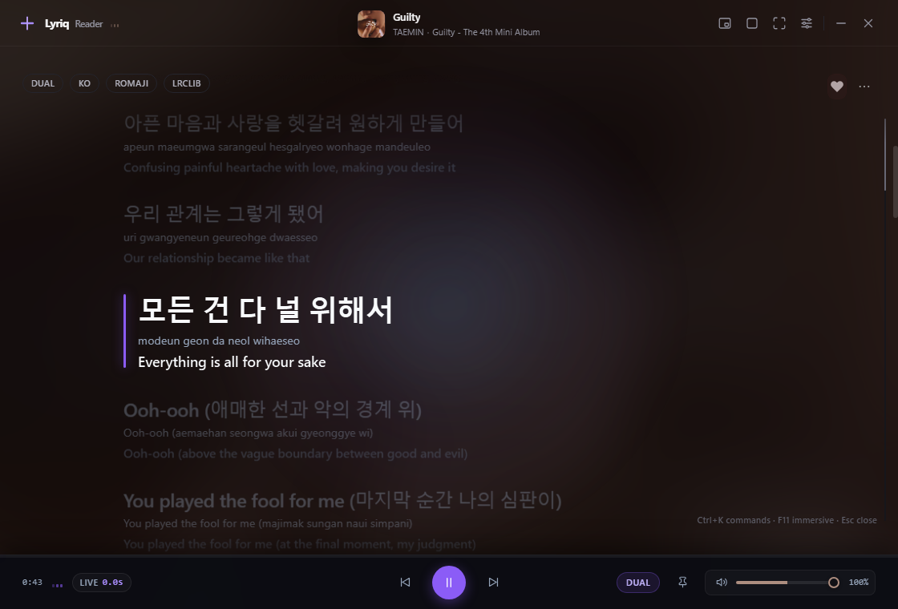
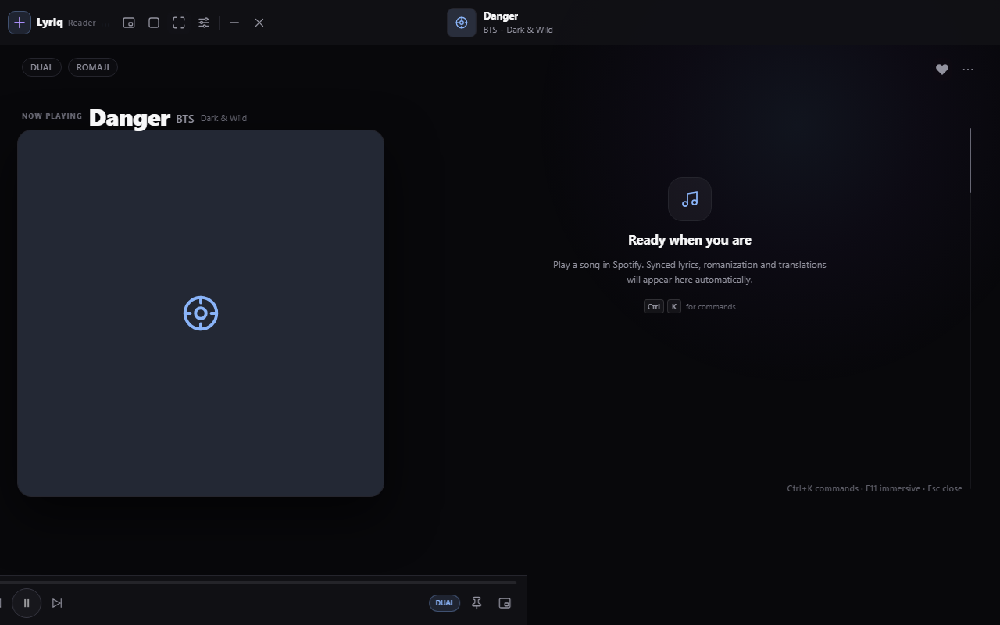
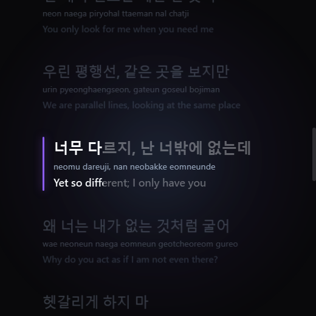
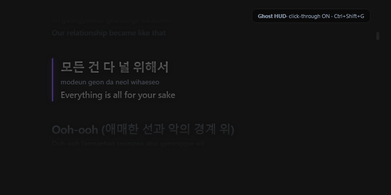
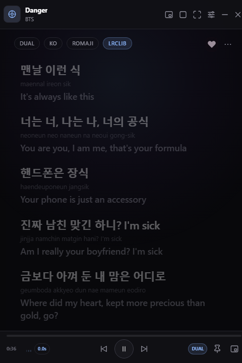
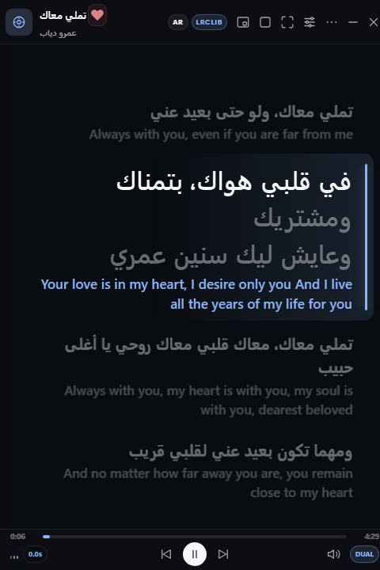
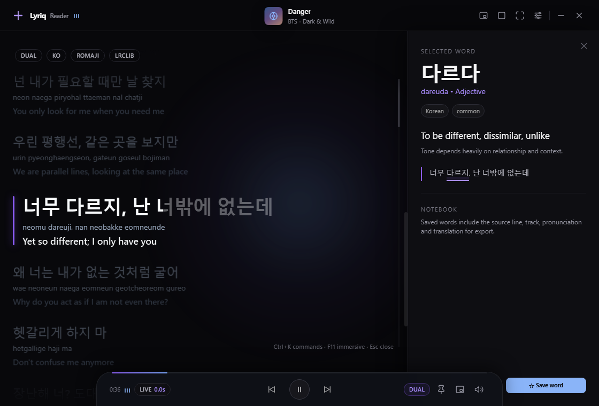
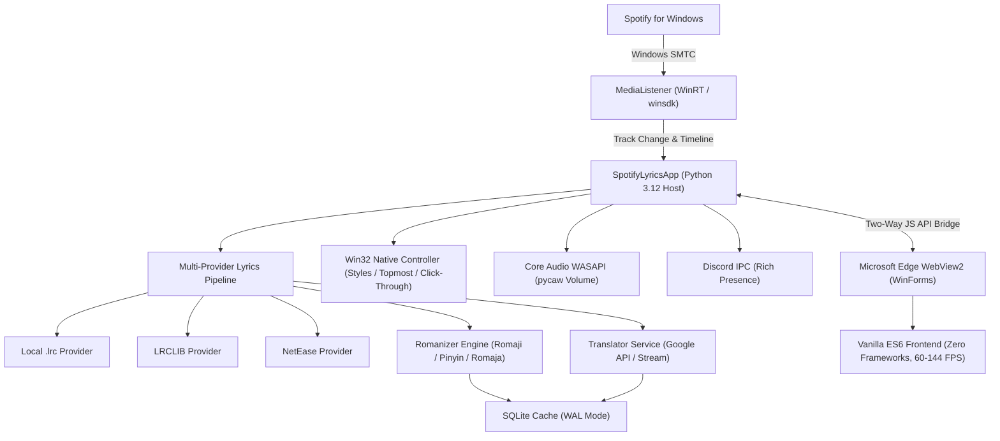

<p align="center">
  
</p>

<h1 align="center">Lyriq (v3.0)</h1>

<p align="center">
  <strong>A high-performance, lyrics-first desktop instrument for Spotify on Windows.</strong><br>
  Real-time synchronized karaoke typography, multi-line translation, phonetic romanization (Romaji / Pinyin / Romaja), and zero-distraction desktop presentation modes.
</p>

<p align="center">
  <a href="https://github.com/Kingof3O/Lyriq/releases/latest"></a>
  
  
  
  
  <a href="LICENSE"></a>
</p>

<p align="center">
  <a href="#-quick-start--downloads"><strong>⬇️ Downloads</strong></a> •
  <a href="#-product-philosophy"><strong>💡 Philosophy</strong></a> •
  <a href="#-presentation-modes"><strong>🖥️ Presentation Modes</strong></a> •
  <a href="#-features"><strong>✨ Key Features</strong></a> •
  <a href="#️-keyboard-shortcuts"><strong>⌨️ Shortcuts</strong></a> •
  <a href="#-architecture"><strong>🛠️ Architecture</strong></a> •
  <a href="#-development--building"><strong>📦 Building</strong></a>
</p>

---

## ⚡ Quick Start & Downloads

### Download Standalone Binary (No Installation Required)

Lyriq is packaged as a standalone 64-bit Windows executable. **You do not need Python, Node.js, or any developer tools to run it.**

| Package | Format | Description | Download |
|---|---|---|---|
| **Lyriq Portable Zip** | `.zip` (~40 MB) | Complete package with `Lyriq.exe` and quick start documentation | [**Download .zip**](https://github.com/Kingof3O/Lyriq/releases/latest/download/Lyriq-v3.0-Windows.zip) |
| **Lyriq Standalone EXE** | `.exe` (~40 MB) | Single-file binary. Put it anywhere and double-click to run | [**Download .exe**](https://github.com/Kingof3O/Lyriq/releases/latest/download/Lyriq.exe) |

1. Download **`Lyriq-v3.0-Windows.zip`** (or `Lyriq.exe`).
2. Run **`Lyriq.exe`**.
3. Open **Spotify for Windows** and play any track.
4. Synchronized lyrics, translations, and romanizations stream automatically!

---

## 💡 Product Philosophy

> **LYRICS FIRST → CONTROLS SECOND → APPLICATION CHROME THIRD**

Lyriq is designed specifically as a **desktop lyrics instrument**, not a Spotify replacement.

- **Spotify owns**: Library management, audio streaming, playlist curation, discovery algorithms.
- **Lyriq owns**: Synchronized typography, sub-millisecond karaoke timing, multi-line translation, phonetic romanization, provider fallback matching, vocabulary study, and immersive presentation modes.

The lyrics stage is the product. There are **no permanent left navigation sidebars**, no generic SaaS cards, no intrusive ads, and no global window scroll jitter.

---

## 📸 Visual Showcase

### Primary Reader Mode
<p align="center">
  
</p>

*Clean synchronized typography with 3px violet active rail, dynamic ambient album atmosphere, and a full-width edge-to-edge media player dock.*

---

## 🖥️ Presentation Modes

Lyriq adapts to whatever you are doing on your PC with five dedicated presentation modes:

| Mode | Shortcut | Preview | Description |
|---|---|---|---|
| **Reader Mode** | Default |  | The canonical desktop lyrics instrument with smooth word-by-word active sweep, translation, and romanization. |
| **Fullscreen Split** | <kbd>F11</kbd> |  | Immersive high-definition split stage: album artwork on the left, full synchronized lyric scroll on the right. |
| **Square Mode** | <kbd>Ctrl</kbd>+<kbd>Shift</kbd>+<kbd>S</kbd> |  | Compact vinyl album card view with integrated controls, ideal for secondary vertical or horizontal monitors. |
| **Mini Island** | <kbd>Ctrl</kbd>+<kbd>Shift</kbd>+<kbd>M</kbd> |  | Ultra-compact floating pill widget. Always on top, docked near your taskbar or corner with live lyric scroll. |
| **Gamer Ghost HUD** | <kbd>Ctrl</kbd>+<kbd>Shift</kbd>+<kbd>G</kbd> |  | 100% click-through transparent HUD (`WS_EX_TRANSPARENT`). Play games or write code with lyrics floating on top. |

---

## ✨ Key Features

### 🎵 Multi-Provider Sync Engine
- **Local `.lrc` Priority**: Drop custom or edited `.lrc` files into `%LOCALAPPDATA%\SpotifyLyrics\lrc\` to immediately override remote sources.
- **LRCLIB**: Primary global crowd-sourced synced and unsynced lyrics catalog.
- **NetEase Cloud Music**: Secondary high-coverage Asian music provider with bilingual and native translated lyrics.
- **Manual Lyrics Search**: Search any song across all providers, inspect match similarity scores, and pick the best candidate on the fly (<kbd>Ctrl</kbd>+<kbd>K</kbd> → *Search lyrics*).

<p align="center">
  
</p>

### 🌐 Real-Time Translation & Phonetic Romanization
- **3 Lyric Views**: Switch effortlessly between **DUAL** (Original + Translation), **TRANSLATION ONLY**, or **ORIGINAL ONLY**.
- **Asian Phonetic Romanization**:
  - **Japanese**: Hepburn Romaji conversion.
  - **Korean**: Revised Romanization (Romaja) transcription.
  - **Chinese**: Pinyin transcription with accurate syllable mapping.
- **RTL (Right-to-Left) Support**: Native bidirectional typography rendering for Arabic, Hebrew, and Persian lyrics.

<p align="center">
  
</p>

### 🎓 Study Lens & Vocabulary Notebook
- Double-click any foreign word in the lyrics to instantly open the **Study Lens** sidebar.
- Inspect dictionary definitions, parts of speech, phonetic pronunciation, and contextual nuance notes.
- Star words to save them to your personal **Vocabulary Notebook** and export them to CSV study decks for Anki or Quizlet.

<p align="center">
  
</p>

### 🎛️ Hardware-Level Volume Control & Media Dock
- **Direct Spotify Volume Control**: Direct Windows Core Audio (WASAPI) session control — adjusting the slider modifies Spotify's volume directly without altering global Windows system sounds.
- **Mouse Wheel Gesture**: Simply scroll your mouse wheel over the album artwork or the player dock to raise or lower the volume.
- **Full-Width Integrated Scrubber**: 3px hairline scrubber spanning edge-to-edge along the top rim of the dock, expanding to 5px with illuminated handle on hover.

### 🎧 Discord Rich Presence
- Broadcasts the currently playing song title, artist name, elapsed track timestamps, and official Lyriq brand artwork directly to your Discord profile.
- Built-in IPC pipe connector with customizable Application ID support in Settings.

### ⚡ Command Palette (<kbd>Ctrl</kbd> + <kbd>K</kbd>)
- Quick launcher for everything: cycle themes, toggle presentation modes, search lyrics, inspect song playback history, manage saved vocabulary, and export `.lrc` / `.srt` / HTML lyric sheets.

<p align="center">
  
</p>

### 💾 Data Persistence & Portable Mode
- **Persistent Local Database**: Caches, settings, song history, and vocabulary are saved permanently in `%LOCALAPPDATA%\SpotifyLyrics\spotify_lyrics.db` with SQLite Write-Ahead Logging (WAL).
- **Portable Mode**: Place an empty `portable.flag` file beside `Lyriq.exe`. All databases, settings, and logs will be isolated to `./data/` on your USB flash drive.

---

## ⌨️ Keyboard Shortcuts

| Shortcut | Action | Scope |
|---|---|---|
| <kbd>Ctrl</kbd> + <kbd>K</kbd> | Open / Close Command Palette | In-app |
| <kbd>F11</kbd> | Toggle Fullscreen Split Stage | In-app |
| <kbd>Esc</kbd> | Close Fullscreen / Modals / Palette / Study Lens | In-app |
| <kbd>Ctrl</kbd> + <kbd>Shift</kbd> + <kbd>G</kbd> | Toggle Gamer Ghost HUD (Click-Through) | Global (System-wide) |
| <kbd>Ctrl</kbd> + <kbd>Shift</kbd> + <kbd>M</kbd> | Toggle Mini Island Overlay Bar | Global (System-wide) |
| <kbd>Ctrl</kbd> + <kbd>Shift</kbd> + <kbd>S</kbd> | Toggle Square Album Card Mode | Global (System-wide) |
| <kbd>Ctrl</kbd> + <kbd>Shift</kbd> + <kbd>H</kbd> | Boss Key (Instant Hide / Show to Tray) | Global (System-wide) |
| <kbd>Ctrl</kbd> + <kbd>Shift</kbd> + <kbd>L</kbd> | Cycle Lyric View Mode (Dual / Trans / Orig) | Global (System-wide) |
| <kbd>Ctrl</kbd> + <kbd>Shift</kbd> + <kbd>Space</kbd> | Play / Pause Spotify | Global (System-wide) |

---

## 🛠️ Architecture



---

## 📦 Development & Building

### Running from Source
Requires **Python 3.12+** on Windows 10 or 11:

```powershell
# Clone the repository
git clone https://github.com/Kingof3O/Lyriq.git
cd Lyriq

# Install dependencies
pip install -r requirements.txt

# Run developer test suite (112 unit tests)
python -m unittest discover -s tests

# Launch application
python main.py
```

### Compiling Standalone Executable
```powershell
# Install build tools
pip install -r requirements-dev.txt

# Compile standalone Lyriq.exe
python build.py
```
The build script bundles the modular ES6 frontend, generates the multi-resolution `.ico`, runs PyInstaller, and produces an optimized standalone executable at `Lyriq.exe`.

---

## 🔒 Privacy & Local Storage

- **No Account Required**: Lyriq reads the Windows System Media Transport Controls (SMTC) broadcast emitted by the Spotify desktop client. No Spotify account credentials or developer tokens are needed.
- **Zero Telemetry**: Lyriq contains zero trackers, analytics, or background telemetry.
- **Local Storage**: All history, saved vocabulary, lyrics caches, and configuration settings remain stored locally on your device in SQLite.

---

## 📄 License

This project is licensed under the **MIT License** — see the [LICENSE](LICENSE) file for details.

Developed with ❤️ by [Kingof3O](https://github.com/Kingof3O).
