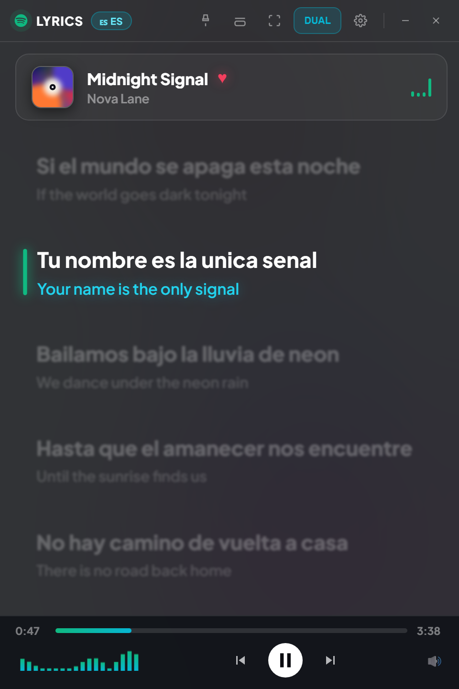
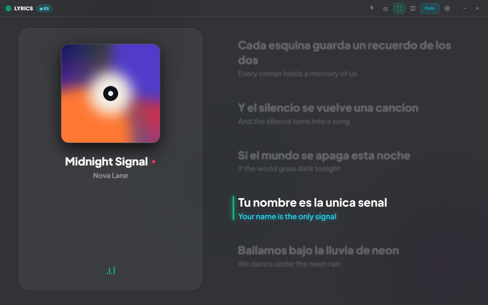
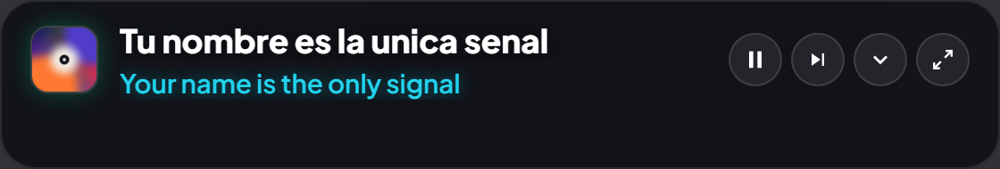
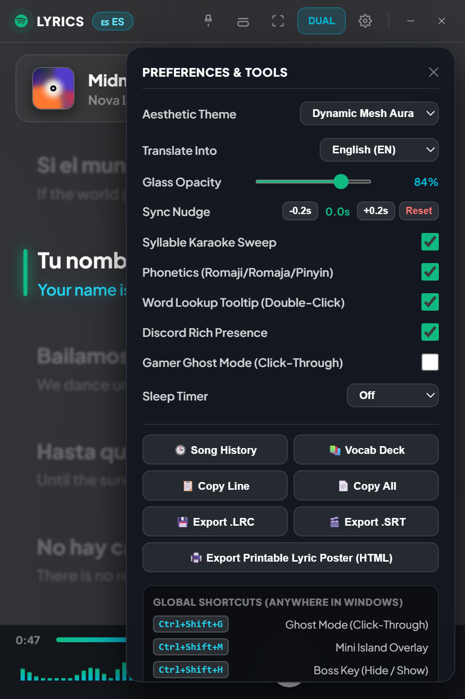
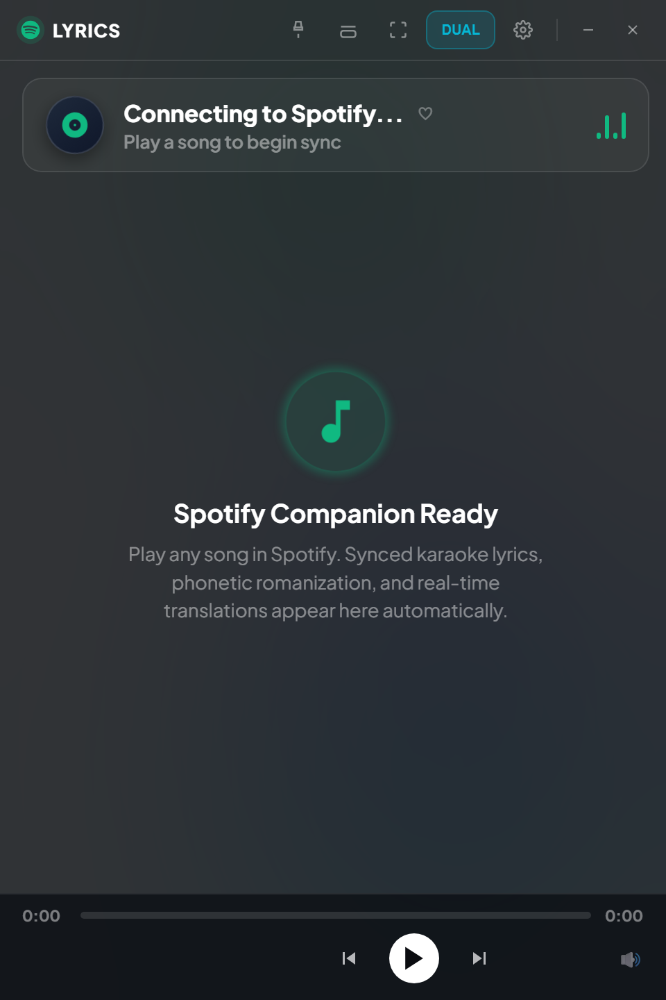

# Spotify Lyrics — Product, UX & Engineering Audit

**Date:** 2026-10-24
**Scope:** `C:\pw\spotify-lyrics` — Python/pywebview backend, HTML/CSS/JS UI, packaged Windows executable
**Audit type:** read-only code review + runtime probes + visual review + memory measurement
**Sample data in screenshots is fictional; no real lyrics were used.**

---

## 1. Verdict

**This is a strong prototype with a genuinely useful core, wearing a 2021 glassmorphism skin and carrying several 2018 dashboard habits.**

The hard part — native Windows SMTC integration, synced lyrics, bilingual translation, global hotkeys, mini/fullscreen modes, export, vocabulary — is already built. The problem is that the finish, reliability and distribution are still prototype-grade:

| Area | Score | Summary |
|---|---:|---|
| Core idea & feature breadth | 8/10 | Ambitious, genuinely useful, differentiated by translation + learning tools |
| Reliability / correctness | 4/10 | Data loss in the packaged build; lyric races; unsynced lyrics broken; history clicks broken |
| Visual design | 5/10 | Clean dark palette, decent active-line treatment, but dated glass/neon/emoji language |
| UX & accessibility | 3/10 | Broken tooltips, no labels, cramped 480 px chrome, settings reset, no keyboard flow |
| Performance / memory | 3/10 | ~575 MB working set / ~413 MB private at idle on this machine; heavy blur/font/IPC choices |
| Distribution / maintainability | 3/10 | No tests, no requirements, no license, no CI, unsigned one-file exe, version mismatch |
| **Overall** | **4.5/10** | **Promising product, not a shippable 2.5 release yet** |

The good news: most of the visual and memory problems are fixable without a rewrite. The data-loss and lyric-race bugs are small, surgical fixes. The feature ideas below are ordered so the app can feel modern in days, not months.

---

## 2. What already works well

- **Native SMTC integration** instead of PowerShell polling. This is the right foundation and is better than many Python lyrics apps.
- **Event-driven seeking** and a client-side 60 fps position interpolator, so the lyrics do not depend on IPC every frame.
- **Three useful view modes** (dual / translation-only / original-only) and three form factors (window, mini, fullscreen).
- **Album-art colour extraction** is a good instinct — it is just hidden behind an almost-opaque glass layer.
- **Global hotkeys** for ghost mode, mini mode, boss key, view cycling and play/pause are genuinely useful for a companion app.
- **Export options** (LRC, SRT, printable HTML), vocabulary notebook and history show product thinking beyond “lyrics on screen”.
- **The active-line treatment** (white + green bar + scale) is readable at a glance. The dark palette suits a music overlay.

Keep this core. The recommendations are mostly about making it trustworthy, fast and current.

---

## 3. Release blockers (fix before calling it 2.5)

### P0-1. Packaged app loses all user data on exit

`cache_service.py` chooses its database path with:

```python
base_dir = os.path.dirname(os.path.abspath(__file__))
db_path = os.path.join(base_dir, "lyrics_cache.db")
```

In a PyInstaller one-file build, an imported module's `__file__` lives inside `sys._MEIPASS`, the temporary extraction folder. I verified this with a one-file probe built from the same `cache_service.py`:

```
db_path = C:\Users\...\Temp\_MEI00003c0c2\lyrics_cache.db
exists  = True
```

`_MEI...` is deleted when the app exits. Therefore, in the shipped `SpotifyLyrics.exe`:

- favourites are lost on every restart
- song history is lost
- vocabulary notebook is lost
- cached lyrics/translations are lost
- translation language/offset/theme (except theme in `localStorage`) are lost

The `lyrics_cache.db` in the repo is not produced by the packaged exe; it is consistent with a source run. This is the single most important bug in the project.

**Fix:** use `%LOCALAPPDATA%\SpotifyLyrics\` (`platformdirs` or `SHGetKnownFolderPath`), create `data.db`, `settings.json`, `art/`, `logs/`. Offer a “portable mode” that stores beside the exe only when the user asks. Add `PRAGMA user_version` migrations and export/import.

### P0-2. Stale lyric fetches and skipped songs

`main.py` uses a single global flag:

```python
if self.is_fetching:
    return
self.is_fetching = True
```

If the user skips from song A to song B while A is still fetching, **B's fetch is dropped**. When A's fetch finishes, it calls `window.updateLyrics(...)` and can paint A's lyrics over B. There is no request token, no cancellation, and no “is this still the current track?” check before applying the result.

**Fix:** give each fetch a `(track_key, request_id)`, cancel or supersede the previous one, and before every `evaluate_js` verify `request_id == current_request_id`. Use a small worker pool with a latest-wins queue. Do the same for translation.

### P0-3. Unsynced lyrics highlight the last line immediately

`parse_lrc` assigns `time = -1` to plain-text lines. The JS never checks `is_synced`; `updatePosition` treats every `-1` as “already passed”, so the active index becomes the last line as soon as playback starts.

I reproduced it in the live page with 80 plain lines:

```
unsyncedActiveId: "line-79"
unsyncedActiveIsLast: true
```

For a song with plain lyrics, the UI therefore highlights and scrolls to the final line at 0:00.

**Fix:** if `!is_synced`, render a static lyric sheet with no active-line highlight and no auto-scroll. Show a small “Not time-synced” badge. Optionally offer a tap-to-sync tool later.

### P0-4. Thumbnail and full state are re-sent every 1.2 seconds

`media_listener._emit_state` includes the cached base64 thumbnail in every state payload. `main.on_media_update` then sends the entire JSON to JS every 1.2 s. The thumbnail can be up to 2.5 MB binary → ~3.3 MB base64. Even a 100 KB image becomes a ~130 KB string every 1.2 s, plus JSON serialization and a new `` assignment.

**Fix:** send artwork only when the track changes; cache it on disk keyed by track; send position/status deltas only. `window.updateTrack` should never receive the same base64 string twice per second. Also stop querying `is_favorite` from SQLite every tick.

### P0-5. Tooltips are defined in HTML but do not exist in CSS

Every nav icon uses `class="tooltip"` and `data-tip="..."`, but `style.css` has no `.tooltip` rule. The buttons also have no `title` or `aria-label`. Verified in the live page:

```
pinTitle: null
pinAria: null
tooltipContent: "none"
```

So the six `.tooltip` controls — pin, mini, fullscreen, split, settings and the “DUAL” view switcher — have neither a visible label nor a working tooltip. (Minimise and close do have `title` attributes, but the rest do not.) This is both a UX and accessibility failure, and it makes the toolbar feel like a mockup.

**Fix:** implement a real tooltip component (hover + focus), add `aria-label`/`title`, and provide visible text labels or a labelled overflow menu.

### P0-6. History clicks hijack the live view, then get overwritten

Clicking a history row calls `load_history_song`, which starts a lyrics fetch for the clicked song but **does not change what Spotify is playing**. The next media tick (≤1.2 s) updates the UI back to the live track. The user sees a flash of the wrong song, or wrong lyrics attached to the current song.

**Fix:** either open the song in Spotify (needs Web API/OAuth or a `spotify:track:` URI with an ID) or open a read-only “preview lyrics” panel that freezes live-follow with a clear “Back to live” button. Do not silently replace the live view.

### P0-7. HTML injection in history, vocabulary and exported posters

`renderHistory()` and `renderVocab()` build `innerHTML` from `title`, `artist`, `word`, `romaji`, `meaning`. Those values can originate from community-editable LRCLIB metadata or translation output. The printable HTML export also interpolates lyric text without escaping.

In a pywebview app, injected script can call the exposed `pywebview.api` methods (write files to Desktop, close the app, etc.). Low likelihood, real impact. **Fix:** build nodes with `textContent`, or escape every interpolated field; add a Content-Security-Policy; do not expose destructive API methods without a capability check.

### P0-8. Settings do not persist

Only the theme is saved to `localStorage`. Language, opacity, sync offset, sweep, romaji, learner tooltip, Discord, ghost, sleep timer, window size/position, and per-song offsets all reset on restart. For a companion app, this makes it feel like a demo.

**Fix:** persist a typed settings object to `settings.json` in the data folder; save window geometry via Win32 `SetWindowPlacement`; save per-song offset in SQLite.

### P0-9. Minor but real correctness bugs

- **Sleep timer resumes paused playback.** `trigger_pause` always calls `toggle_play_pause`; if Spotify was already paused, it starts playing. It should pause only when `status == playing`, and ideally fade out.
- **Discord RPC likely never connects.** `CLIENT_ID = "121456789012345678"` is described in the code itself as a “Generic rich presence client ID”. Discord requires a registered application ID, and the `spotify`/`live` asset keys must exist in that app. Either register a real app or remove the feature instead of showing a dead toggle.
- **Version mismatch.** README says v2.5, `build.py` says v2.0, the exe is named `SpotifyLyrics-v2.exe`, and the LRCLIB user agent says 2.5. Pick one source of truth.
- **No single-instance lock.** Launching the exe twice creates two windows, two media listeners, duplicate hotkey registrations (the second fails silently) and two Discord pipes.
- **Mini mode is a resized window, not a floating overlay.** `toggle_mini_mode` resizes the main window to 560×95; `transparent=False`. It is a compact window, not a true click-through pill, and there is no progress line.

---

## 4. Why it feels like 2018 (visual teardown)

The screenshots below are from the actual HTML/CSS with fictional sample data, rendered at the real window sizes.



### The seven tells

| Tell | Why it reads dated | Modern replacement |
|---|---|---|
| **Glassmorphism + neon cyan glow + three animated mesh orbs + “Cyberpunk 2077” / “Tokyo Night” themes** | This is the 2020–2022 Dribbble dark-dashboard template. Worse, the orbs sit behind an 84%-opaque glass layer, so the signature effect is almost invisible; the result is a flat grey window. | Windows 11 Mica/Acrylic (via DWM) or one static, blurred album-art backdrop with a dark scrim. Neutral surfaces; one accent sampled from the artwork. No animated orbs. |
| **Emoji used as icons, mixed with inline SVGs and text glyphs** | `🕒 📚 📋 📄 💾 🎬 🖨️ 🔊 ⭐ ♡ ♥ ✕` sit next to 14 px stroked SVGs. Emoji rendering varies by Windows version; country flags do not render as flags on Windows (the badge shows “ES ES”). It reads as a prototype. | One icon family — Fluent System Icons, Lucide or Phosphor — at 16/20 px, 1.5–1.75 px stroke, in an SVG sprite. Replace emoji with vector icons. Tooltips + labels. |
| **Tiny uppercase micro-labels** (“LYRICS”, “DUAL”, “PREFERENCES & TOOLS”, 10–13 px with letter-spacing) | The 2018 SaaS dashboard habit. It makes the app look like a control panel, not a music experience. | Sentence case, 3–5 type sizes, 13–15 px minimum for secondary text, fewer weights. Let the lyrics be the biggest type on screen. |
| **Native checkboxes, selects and range inputs inside a glass skin** | Big green square checkboxes and default browser selects clash with the custom surface. It immediately signals “web page”, not “desktop app”. | Custom switches/segmented controls with proper focus states; or use real WinUI/Fluent controls if you go native. |
| **Cramped 480 px toolbar with 9 controls** | Pin, mini, fullscreen, split, DUAL, settings, divider, minimise, close. No labels, no tooltips, 14 px icons. The user has to guess. | 3 primary actions + an overflow menu; auto-hide the chrome; use a command palette (Ctrl+K) for the rest. |
| **Lyrics are the smallest part of the window** | Navbar (44 px) + track card (~84 px) + dock (~65 px) consume ~27% of a 720 px window. With 24 px gaps and blurred inactive lines, only 3–4 lines are readable. | Collapse the track card into a 52–56 px top bar or let it auto-hide. Reduce lyric gap to 12–16 px. Give lyrics 85–90% of the surface. |
| **Blur on every inactive lyric line** | `filter: blur(1.2px)` + opacity 0.38 makes upcoming lines unreadable and is expensive to paint. Apple Music dims and scales; it does not blur. | Opacity 0.35–0.55 plus a slight scale; no blur. Active line 32–40 px, inactive 20–24 px. |
| **Rainbow accents** | Spotify-ish green + cyan translation + purple romaji + red heart + blue flag + teal controls. The cyan glow on every translation is the “AI 2023” look. | One accent from album art. Colour only for state (active line, error, success). Translation should be secondary text, not a neon headline. |
| **Settings drawer covers 71% of the window** | 340 px drawer in a 480 px window; 8 settings rows + 7 action buttons + a hotkey legend below the fold. No search, no click-outside close, no focus trap. It hides the very content it is configuring. | A preferences window/sheet with a sidebar: Appearance, Playback, Lyrics, Translation, Shortcuts, Data, About. Searchable. Switches. Reset per section. |
| **Empty state is a landing page** | “Spotify Companion Ready” + a three-line marketing paragraph + a pulsing halo. It reads like a website hero, not an app state. | Quiet status: “Spotify connected · Play something” + an “Open Spotify” button + one shortcut hint. |
| **Google Fonts in an offline desktop app** | The page loads 4 families including 3 CJK Noto families. The stylesheet alone was 248 KB and declared **1,067** `@font-face` rules. CJK subsets download on demand; without network the typography degrades. | Segoe UI Variable for Latin, system CJK fonts (Yu Gothic UI / Malgun Gothic / Microsoft YaHei UI), or a bundled Latin variable font. Zero network dependency. |
| **Motion overload** | Orbs float, radar pulses, vinyl spins, equalizer bounces, pill pulses, translation glows. No `prefers-reduced-motion`, no pause when idle. | Purposeful spring transitions for line changes; pause all ambient motion when paused/hidden; respect reduced motion and reduced transparency. |
| **Window is a phone-shaped 480×720** | The layout is a mobile column stretched into a desktop window. No wide layout, no maximise button, no snap, no remembered geometry. | Compact (420–480 px), wide (900–1100 px with art + lyrics + queue), fullscreen and overlay. Remember size/position; support snap and maximise. |

### Fullscreen split view



This is the clearest example of “looks like a concept, not a product”:

- The left card is 42% of the screen and mostly empty: a 260 px album cover, title, tiny heart, and a decorative equalizer at the bottom.
- The player dock is hidden (`display: none !important`), so **there are no play/pause/seek controls in split fullscreen**.
- The right column is fine, but the lyrics are still blurred/dim; the active line is the only readable thing.
- At 1280 px the top bar stays at 13–14 px, so the chrome looks like a browser toolbar rather than a cinema mode.

**Fix:** either fill the left panel with queue/artist/album/controls, or make the album art full-bleed and overlay a minimal control bar. Never hide all playback controls.

### Mini mode



The compact bar concept is good, but:

- It is a resized 560×95 window, not a true transparent overlay.
- No progress line, no previous button, no pin/close on hover.
- Four 30 px icon buttons with ambiguous fold/expand glyphs.
- No shadow/transparency around the pill; the “floating” effect is limited.

**Fix:** native layered window with true transparency, 2 px progress at the bottom, pin + close on hover, and a clear “expand to full window” affordance.

### Settings drawer



The drawer is functional but visually and structurally dated: native controls, giant green checkboxes, emoji action buttons, long technical labels (“Syllable Karaoke Sweep”, “Word Lookup Tooltip (Double-Click)”), and the hotkey legend below the fold. A 2026 app would use a preferences window with sections, switches, a search field and a proper language picker.

### Idle state



The idle state is clean, but it is built like a landing-page hero: a headline, a three-line instruction and a pulsing halo. The static default says “Connecting to Spotify…”; once the listener runs, “Waiting for Spotify…” replaces it, but the structure is the same. A quiet status line and an “Open Spotify” action would be more useful than marketing copy. The fake spectrum at the bottom looks like a loading animation.

---

## 5. Performance & memory audit

### Measured baseline

On this Windows machine, app idle (no track playing), the process tree was:

| Process | Working set | Private bytes |
|---|---:|---:|
| SpotifyLyrics (Python) | 145 MB | 106 MB |
| WebView2 processes (6) | ~430 MB | ~306 MB |
| **Total** | **~575 MB** | **~413 MB** |

That is **not memory-friendly** for a lyrics companion. WebView2 has a real baseline, but the app is making it worse than necessary.

### What is driving it

1. **Full-window `backdrop-filter: blur(40px) saturate(200%)`** over an animated background. This forces the compositor to re-blur a full-window backdrop every frame. On a 4K fullscreen window this is a large offscreen buffer.
2. **Three 320–420 px orbs with `filter: blur(90px)`** animated continuously for 18 s each. Large blurred layers, always animating.
3. **`filter: blur(1.2px)` on every inactive lyric line.** Each line becomes its own rasterised layer; dozens of lines × blur = paint cost.
4. **Two `requestAnimationFrame` loops** — the position loop and the spectrum visualiser — plus `scrollIntoView({behavior:'smooth'})` on every line change.
5. **Fake spectrum**: 18 new `createLinearGradient` objects every frame. It is not audio data; it is a sine/cosine animation. Pure decoration with real cost.
6. **Google Fonts**: 248 KB CSS, 1,067 `@font-face` rules, 4 families including CJK; font files download on demand and are not available offline.
7. **Base64 album art every 1.2 s** plus full JSON IPC (see P0-4).
8. **Duplicate lyric DOM**: the main list and the mini drawer both render every line, even if the user never opens mini mode. A 120-line song produced 1,462 DOM nodes and 1.4 MB JS heap before translations; for a 300-line song this scales poorly.
9. **SQLite query every 1.2 s** for `is_favorite`; separate connections opened per call; no cache cap or pruning.
10. **PyInstaller one-file**: the 23.7 MB exe extracts ~722 files to `%TEMP%` on every launch. Slower startup, more disk I/O, and a higher chance of antivirus false positives.

### Fix order (highest impact first)

| Change | Expected effect |
|---|---|
| Bundle/system fonts; drop Google Fonts | −248 KB CSS, no network dependency, no CJK subset downloads, faster first paint |
| Remove full-window backdrop blur + orbs; use a static blurred album layer + scrim | Large GPU/compositor savings; better battery; no visual loss if done well |
| Remove per-line blur; use opacity/scale | Fewer layers, less paint, better readability |
| Send artwork once per track; send deltas only | Big IPC/string/GC reduction |
| One RAF gated by `isPlaying && !document.hidden`; CSS karaoke animation; throttle time text | Lower CPU/GPU when paused/idle |
| Lazy-build the mini list; `content-visibility: auto` for offscreen lines; virtualise >200 lines | Lower DOM/paint for long songs |
| Single SQLite connection, WAL, cache cap, prune LRU | Lower DB overhead, bounded disk |
| Remove fake spectrum, or make it real WASAPI and on-demand | Lower CPU; honesty |
| Mica via DWM instead of CSS blur | Native look with less GPU work |
| One-folder build or installer | Faster startup, fewer AV issues |

**Realistic target without a rewrite:** ~250–350 MB working set while playing, <1% CPU idle. **If you need <200 MB**, a native WinUI 3/Win2D rewrite (the BetterLyrics approach) is the only reliable path. A Tauri rewrite still uses WebView2 and would not solve the baseline.

Add a **Low Power mode** toggle: static background, no visualiser, 30 fps position updates, no blur, reduced motion. This is a feature users will actually use on laptops.

---

## 6. Functional gaps that matter more than new features

These are not “nice to have”; they are why users will trust or abandon the app.

1. **No manual lyric matching.** Automatic LRCLIB matching fails for live versions, remixes, CJK titles, deluxe editions, and songs with punctuation. Every mature lyrics app has a “search / choose the right result” dialog. Currently there is only “Search Again”.
2. **No per-song offset.** A global ±0.2 s nudge is not enough; different sources have different offsets. Persist offset per `(provider, track)` and offer “tap to sync” calibration.
3. **No local `.lrc` import or drag-and-drop.** Obscure songs, concert recordings and non-Western catalogues will never be covered by one API. Local files are the escape hatch.
4. **Only one lyrics provider (LRCLIB).** No fallback if LRCLIB is down or missing the song. Lyricify/BetterLyrics aggregate multiple sources. Add a provider interface and at least NetEase/QQ for CJK, plus local files.
5. **No “unsynced” mode** (see P0-3). Plain lyrics are common; the current behaviour is broken.
6. **No translation privacy story.** Every lyric line is sent to Google’s unofficial `translate_a/single` endpoint. There is no disclosure, no opt-out, no provider choice, no offline option. This is a trust issue for a desktop app.
7. **No Arabic/Hindi RTL or font support.** The target language list omits Hindi even though the README claims it. Tested Arabic text computed `direction: ltr`; Arabic punctuation and mixed-direction lines will look wrong.
8. **No Chinese pinyin** despite the UI label “Romaji/Romaja/Pinyin”. `Romanizer.romanize()` returns `""` for Chinese. Japanese romanisation also misses small tsu, long vowels and kanji.
9. **No true word-level karaoke.** The “syllable sweep” is a linear gradient across the whole line, based on line duration — not word timing. It looks like karaoke but is not synced to syllables. Label it “line progress” or implement real word timing.
10. **No consistent error states.** Network failure, LRCLIB rate limit, missing lyrics and “no Spotify session” all end up as similar generic messages. Add distinct states with Retry / Search / Open logs.
11. **No cache management or privacy controls.** Users cannot see how much data is stored, clear history, disable history recording, or export their vocabulary/favourites.
12. **No single instance, tray, startup, or close-to-tray.** For an always-on companion, these are table stakes.

---

## 7. Eighteen features worth adding (10–20 requested)

Priority: **P0** = fix before calling it stable, **P1** = next release, **P2** = differentiator, **P3** = later. Effort: S/M/L/XL.

### Necessary / table stakes

| # | Feature | Priority | Effort | Why it matters / who does it well |
|---:|---|---|---|---|
| 1 | **Persistent data + settings + portable mode + import/export** | P0 | S | Fixes the packaged-build data loss. Store in `%LOCALAPPDATA%`; schema migrations; export favourites/history/vocab as JSON/CSV; optional “portable” data folder. |
| 2 | **Reliable lyric pipeline**: per-track cancellation, negative cache, unsynced mode, per-song offset, manual search/match, local `.lrc` import | P0 | M | This is the core promise. Fixes the race, skipped-song and last-line bug; gives users a way out when matching fails. Lyricify and BetterLyrics both have lyric management. |
| 3 | **Multi-provider lyrics + fallback + source badge + attribution** | P1 | M | LRCLIB alone will never cover every live/remix/CJK track. Add NetEase/QQ for CJK, Musixmatch/Genius for metadata, local files; score by artist/title/album/duration; show “Lyrics from …”. |
| 4 | **Universal now-playing (any SMTC app) + per-app profiles** | P1 | M | `MediaListener` already uses SMTC. Supporting Apple Music, YouTube Music (browser), Tidal, foobar2000 and local players multiplies the app’s value. Lyricify Fusion does exactly this. |
| 5 | **Tray icon + start with Windows + single instance + close-to-tray + remember window state** | P1 | S | Companion-app basics. Currently closing exits; two launches create duplicate listeners/hotkeys; size/position are forgotten. Use a Win32 mutex + tray icon (`Shell_NotifyIcon`) to stay light. |
| 6 | **Detached desktop overlay + improved mini bar + taskbar lyrics** | P1/P2 | M–L | Users want lyrics over other apps, not a window they must alt-tab to. A true layered/click-through overlay with per-monitor placement; mini bar with progress/pin/close; taskbar lyrics later (Lyricify/SPlayer). |
| 7 | **Preferences + design system**: Mica/Fluent, light/dark/system, album accent, type scale, RTL, searchable language list, custom switches | P1 | M | Fixes the dated look and the cramped drawer. Use design tokens (4/8 px spacing, 8/12/16 radii, 4–5 type sizes), Segoe UI Variable, Fluent icons, `dir="auto"`, a searchable 100+ language picker. |
| 8 | **Privacy-first translation**: provider choice (Google / DeepL / LibreTranslate / offline), disclosure, opt-out, context-aware progressive batches | P1 | M | Today every line goes silently to Google via an unofficial endpoint. Offer a clear data notice, a disable switch, BYO keys, and local/offline options. Stream each chunk as it finishes; validate line counts; use context instead of unordered `set()`. |
| 9 | **Accessibility + command palette**: focus states, ARIA labels, tooltips, keyboard navigation, Ctrl+K, customizable hotkeys, reduced motion/transparency, text scaling | P1 | S–M | Fixes the unlabelled icon toolbar. A command palette (“Search lyrics”, “Change language”, “Toggle mini”, “Export”) makes a feature-dense app discoverable without more chrome. |
| 10 | **Installer + signing + auto-update + diagnostics** | P1 | M | The unsigned one-file exe can trigger SmartScreen, starts slowly due to extraction and gives users no update path. Inno Setup/MSIX + code signing + GitHub Releases update check + `winget`; rotating logs and a “Copy diagnostics” button. |

### Differentiators

| # | Feature | Priority | Effort | Why it matters / who does it well |
|---:|---|---|---|---|
| 11 | **True word/syllable karaoke + duet/background vocals** | P2 | L | The current sweep is a line-level gradient, not word timing. Apple Music Sing, Lyricify Syllable and BetterLyrics set the bar. Support enhanced LRC/word-level sources; fall back to line-level; add duet labels and background vocals. |
| 12 | **Lyric cards / share** | P2 | S–M | Render the current line as a 1080×1350 or 1080×1920 image with 8–10 templates (vinyl, polaroid, minimal, gradient, typographic). Copy PNG or save. BetterLyrics has 10+ templates; high virality, low runtime cost. |
| 13 | **Listening stats / “Wrapped”** | P2 | M | The history table already has the data: top artists, songs, languages, minutes, vocabulary learned. A Wrapped-style story is a retention feature and a natural share artifact. BetterLyrics does this. |
| 14 | **Learning 2.0**: tap a word (not double-click the whole line), dictionary, furigana/pinyin/ruby, SRS review, Anki export, TTS, sentence context | P2 | M | The app’s niche is language learners. Current double-click selects the whole line, saves the whole line, has no pinyin, and has no review loop. Word-level interaction + SRS makes the vocabulary notebook actually useful. |
| 15 | **Spotify OAuth**: liked-songs sync, queue/up-next, precise metadata, play from history, “Open in Spotify” | P2 | M | The heart is local-only, which is misleading; history click is broken. OAuth fixes both and unlocks queue/playlists. Store refresh tokens in Windows Credential Manager, not plaintext. |
| 16 | **Cinema/fullscreen mode**: auto-hide chrome, full-bleed art, controls, queue/artist info, duet layout | P2 | M | The current split view hides all playback controls and leaves a huge empty panel. A proper cinema mode is the “show off” screen for the app. |
| 17 | **Real audio spectrum (WASAPI loopback) or remove the fake one** | P2 | S–M | The current spectrum is a sine/cosine decoration. Either make it real (BetterLyrics/SPlayer use WASAPI) or remove it to save CPU and avoid looking fake. Offer it as an optional “visualiser” with a clear CPU cost. |
| 18 | **AI line explanations / cultural notes** (opt-in, BYO key, local LLM option) | P3 | M | Natural for learners: explain grammar, slang, cultural references, or translate with context. Must be opt-in and privacy-first; do it after the provider abstraction. BetterLyrics is explicitly “AI-ready”. |

### Deliberately not recommended (yet)

- **A full plugin system / SDK.** Only after the provider interface is stable; otherwise it becomes an API you regret.
- **Ten more visual themes.** The problem is not a lack of themes; it is a lack of one coherent, adaptive design. Ship Auto/Light/Dark/High Contrast first.
- **Electron or React.** The current vanilla stack is small and fast enough; adding a framework increases memory and build complexity without solving the real issues.
- **A native rewrite right now.** Fix the UX and the bugs first. If low memory becomes a hard product requirement, a WinUI 3/Win2D rewrite is justified — but validate the design before paying that cost.
- **Cloning the iPhone Dynamic Island literally.** A Windows-native compact flyout with Mica and a progress line will feel more at home than a fake iPhone pill.

---

## 8. What similar GitHub projects do better

Star counts are approximate as of October 2026, from the GitHub API.

| Project | Stars | What to learn / borrow |
|---|---:|---|
| [Lyricify-App](https://github.com/WXRIW/Lyricify-App) (Lyricify 4 / Fusion) | ~7.3k | The closest competitor. Dynamic Lyrics Island, desktop lyrics, taskbar lyrics, fullscreen, vertical lyrics, live album cover, word-level “Lyricify Syllable”, per-app settings, lyric management. Borrow the per-app profiles, overlay modes and lyric management — not the exact visual style. |
| [SPlayer](https://github.com/SPlayer-Dev/SPlayer) | ~7.4k | Word-by-word lyrics, desktop/taskbar lyrics, audio spectrum, local/streaming library. Borrow the word-level format support and the performance discipline. |
| [Beautiful Lyrics](https://github.com/surfbryce/beautiful-lyrics) | ~2.4k | Karaoke/line/static lyrics for everyone, background/side vocals, Page/Cinema/Fullscreen views, dynamic backgrounds, per-language romanisation, auto-update. Borrow the view modes, vocal layers and auto-update. |
| [BetterLyrics](https://github.com/jayfunc/BetterLyrics) | ~2.2k | WinUI 3/Win2D, per-syllable karaoke, trailing long-note glows, spatial perspective fading, chameleon adaptive colours, multi-layout (fullscreen/desktop/taskbar/wallpaper), metadata correction, plugin sources, lyric cards, Wrapped stats, offline/local translation. The benchmark for “modern Windows lyrics app”. |
| [Spotify-Lyrics](https://github.com/mantou132/Spotify-Lyrics) | ~1.1k | Web-player instant synced lyrics; useful for understanding the browser/extension route, less relevant to a SMTC app. |
| [LyricFever](https://github.com/aviwad/LyricFever) | ~639 | macOS menu-bar lyrics app built with SwiftUI, MusicKit and Spotify. Borrow the menu-bar/compact-overlay thinking and the native-platform polish. |
| [Lyricstify](https://github.com/lyricstify/lyricstify) | ~203 | Terminal lyrics with romanisation/translation; shows the demand for the learner features. |
| [LRCLIB](https://lrclib.net) / [tranxuanthang/lrclib](https://github.com/tranxuanthang/lrclib) | — | Your current provider. Keep it as the primary free source, attribute it, and add fallbacks for coverage. |

**The gap you can own:** none of the big projects focus on *bilingual learning* as deeply as this app could. Word-level lookup + SRS + pinyin/furigana + lyric cards + a privacy-first translation provider is a sharper niche than “another lyrics overlay”.

---

## 9. Recommended roadmap

### Phase 0 — Stop the bleeding (3–5 days)
- Fix the `%LOCALAPPDATA%` data path and migrations.
- Fix the fetch race/cancellation and unsynced lyrics.
- Persist settings + window geometry.
- Add tooltips/ARIA labels; fix the history click; fix the sleep timer.
- Escape HTML in history/vocab/exports.
- Send artwork once per track; remove the SQLite query per tick.
- Replace the placeholder Discord client ID or remove the toggle.

### Phase 1 — Make it feel 2026 (1–2 weeks)
- Remove Google Fonts; use Segoe UI Variable + system CJK.
- Remove full-window backdrop blur, orbs and per-line blur; add a static album-art backdrop with a scrim.
- Introduce design tokens, Fluent icons, light/dark/system + album accent.
- Collapse the track card into the top bar; give lyrics 85–90% of the window.
- Replace the settings drawer with a preferences window/sheet (sections, switches, searchable languages).
- Fix the fullscreen split (controls, queue/artist info) and the mini bar (progress, pin/close).
- Add a “Low Power” mode; pause animations when hidden.
- Regenerate README screenshots/GIF; fix versioning.

### Phase 2 — Table stakes (2–4 weeks)
- Manual lyric search/match, per-song offset, local `.lrc` import.
- Multi-provider lyrics + source badges + attribution.
- Universal SMTC + per-app profiles.
- Tray, start with Windows, single instance, close-to-tray.
- Privacy-first translation provider choice + disclosure + progressive streaming.
- Accessibility pass, command palette, customizable hotkeys.
- Installer/signing/update check/diagnostics.

### Phase 3 — Differentiators (1–2 months)
- Word/syllable karaoke + duet/background vocals.
- Detached desktop overlay/taskbar lyrics.
- Lyric cards, stats/Wrapped.
- Learning 2.0 (word tap, SRS, Anki, pinyin/furigana).
- Spotify OAuth (likes, queue, play from history).
- Cinema mode.
- Optional AI line explanations.

### Phase 4 — Scale
- Tests (pytest for parser/cache/provider; Playwright for UI), CI, lint/type checks.
- Plugin/provider SDK only if there is demand.
- Decide on a native WinUI 3 rewrite if memory is a hard requirement.

---

## 10. Keep / don’t lose

- The **SMTC foundation** — it is the app’s technical advantage over browser-based lyrics tools.
- The **three view modes** and the **mini mode concept** — both are useful; they need polish, not removal.
- **Album-art colour extraction** — use it as the single accent and background tint; do not bury it under 84% glass.
- **Global hotkeys, ghost mode, boss key** — distinctive, useful, and easy to explain.
- **Export + vocabulary** — these are the seeds of the learning niche.
- The **dark, quiet palette** — it suits a music companion. The problem is the decoration, not the darkness.

---

## 11. Evidence & method

- Read every source file in the project (`main.py`, `media_listener.py`, `lyrics_service.py`, `cache_service.py`, `translator_service.py`, `romanizer.py`, `discord_rpc.py`, `web/index.html`, `web/style.css`, `web/app.js`, build files).
- Ran the app’s HTML/CSS/JS in a headless browser at the real window sizes (480×720, 560×95, 1280×800) with fictional sample data; captured the screenshots above.
- Probed the live page for unsynced behaviour, tooltip computed styles, Arabic direction, font counts and DOM size.
- Built a minimal PyInstaller one-file probe with the project’s `cache_service.py` to confirm the `_MEIPASS` database path.
- Measured the packaged app’s idle process tree (working set and private bytes) on this machine.
- Checked GitHub for comparable projects and read their READMEs for feature benchmarks.

### Measurements cited

| Metric | Value |
|---|---|
| Idle working set (app + WebView2) | ~575 MB |
| Idle private bytes | ~413 MB |
| Google Fonts stylesheet | ~248 KB |
| `@font-face` rules declared | 1,067 |
| DOM nodes for 120 lyric lines | 1,462 |
| Duplicate mini lyric nodes | 120 (built even when mini mode is closed) |
| Unsynced active line at 0:00 | Last line (`line-79` of 80) |
| Arabic computed direction | `ltr` (should be `rtl` / `dir="auto"`) |
| Nav button tooltip content | `none`; no `title`, no `aria-label` |
| Packaged DB path | `%TEMP%\_MEI...\lyrics_cache.db` (deleted on exit) |
| Exe size | 23.7 MB (one-file, unsigned) |

---

## 12. Bottom line

The app does not need more features first. It needs **trust** (data persistence, correct sync, no races), **breathing room** (lyrics-first layout), and **one coherent visual language** (system fonts, Fluent icons, one accent, no glass/neon/emoji).

After that, the highest-leverage additions are:

1. **Manual lyric match + per-song offset + local `.lrc`** — makes the core reliable.
2. **Multi-source lyrics + universal SMTC** — makes it work for more songs and more players.
3. **Tray/startup/single-instance + a real desktop overlay** — makes it a daily companion.
4. **Word-level karaoke + learning 2.0** — makes it uniquely valuable.
5. **Privacy-first translation + Spotify OAuth** — makes it trustworthy and connected.

Do those, and the app stops looking like a 2018 dashboard and starts feeling like a 2026 Windows music companion.
